<h1 align="center">Welcome to Graph Path</h1>

<p align="center">
  
</p>

<p align="center">
  <b>A graph-based, animated and fully customizable contribution calendar for your GitHub profile.</b>
</p>

<p align="center">
  
  
  
  
</p>

---

Do you want to improve your profile's `README.md` with an interesting, graph-based, fully customizable contribution calendar? Then you are in the right place!

Graph Path reads your contributions from the GitHub API, turns each day into a node of a graph, connects the closest ones and animates a cursor walking through the whole thing. The result is a single `.svg` file, regenerated automatically every day by a GitHub Action.

## Table of Contents

- [🚀 How to Use](#how-to-use)
  - [Step 1: Copy the `graphpath/` folder](#step-1-copy-the-graphpath-folder)
  - [Step 2: Create the `update.py` file](#step-2-create-the-updatepy-file)
  - [Step 3: Create the GitHub Actions workflow](#step-3-create-the-github-actions-workflow)
  - [Step 4: Add a `.gitignore`](#step-4-add-a-gitignore)
  - [Step 5: Create the access token](#step-5-create-the-access-token)
  - [Step 6: Save the token as a repository secret](#step-6-save-the-token-as-a-repository-secret)
  - [Step 7: Run the pipeline](#step-7-run-the-pipeline)
  - [Step 8: Show the calendar in your profile](#step-8-show-the-calendar-in-your-profile)
- [🛠️ Customization](#customization)
  - [What you can change](#what-you-can-change)
  - [Constants reference](#constants-reference)
- [🎨 Themes](#themes)
  - [1. Basic Colors](#1-basic-colors)
  - [2. Year Seasons](#2-year-seasons)
  - [3. Drinks](#3-drinks)
  - [4. Countries and Culture](#4-countries-and-culture)
  - [5. Classical UI](#5-classical-ui)

---

## How to Use

Follow the steps below in order. In the end you will have a calendar that updates itself every day, with no manual work.

> [!NOTE]
> Everything below happens in your **profile repository**, the special repository named exactly like your GitHub username (for example, `Bob/Bob`).

### Step 1: Copy the `graphpath/` folder

See the `graphpath/` folder in this repository? Copy the **entire folder** to the root of your profile repository.

### Step 2: Create the `update.py` file

Add an `update.py` file to the root of your profile repository, with the following content:

```python
from graphpath import update_contribution_calendar

if __name__ == "__main__":
    update_contribution_calendar("YourGitHubUserName",
                                 theme="neon")
```

> [!WARNING]
> Remember to replace `"YourGitHubUserName"` with your actual GitHub username. The second parameter (`theme`) accepts any of the names listed in the [Themes](#themes) section, so feel free to test all of them.

### Step 3: Create the GitHub Actions workflow

Create a `.github/workflows` folder in the root of the repository and add a file called `graphpath.yml` to it, with the following content:

```yml
name: graphpath

on:
  schedule:
    - cron: "0 6 * * *"
  workflow_dispatch:

permissions:
  contents: write

jobs:
  update:
    runs-on: ubuntu-latest
    steps:
      - name: Download repository
        uses: actions/checkout@v4

      - name: Install python
        uses: actions/setup-python@v5
        with:
          python-version: "3.12"

      - name: Generate svg contribution calendar
        env:
          CONTRIB_TOKEN: ${{ secrets.CONTRIB_TOKEN }}
        run: python update.py

      - name: Save to repository if changed
        run: |
          if [ -z "$(git status --porcelain assets/contrib.svg)" ]; then
            echo "No updates were found."
          else
            git config user.name "github-actions[bot]"
            git config user.email "41898282+github-actions[bot]@users.noreply.github.com"
            git add assets/contrib.svg
            git commit -m "auto: update contribution calendar"
            git push
          fi
```


This workflow runs **every day at 06:00 UTC** and can also be started manually (`workflow_dispatch`). When something changes, it commits the new `assets/contrib.svg` file by itself.

### Step 4: Add a `.gitignore`

You may also need a `.gitignore` file in the root of the repository, with at least the following lines:

```gitignore
__pycache__/
*.pyc
.DS_Store
```

### Step 5: Create the access token

The script needs permission to read your contributions. For that, create a **classic** personal access token:

1. Open **GitHub → Settings → Developer settings → Personal access tokens → Tokens (classic)**.
2. Click **Generate new token (classic)**.
3. Give it a name (for example, `graphpath`) and select **only** the `read:user` permission.
4. Click **Generate token** and **copy it right away**, because GitHub will not show it again.

> [!IMPORTANT]
> Never commit the token to the repository. It must live only in the repository secrets, as shown in the next step.

> [!CAUTION]
> If the token expires, the automation will stop working, and a new token must be generated to restore functionality.

### Step 6: Save the token as a repository secret

With the token copied:

1. Go to your profile repository on GitHub and open **Settings → Secrets and variables → Actions**.
2. Click **New repository secret**.
3. In **Name**, type exactly `CONTRIB_TOKEN`.
4. In **Secret**, paste the token you just created.
5. Click **Add secret**.

### Step 7: Run the pipeline

1. Open the **Actions** tab of the repository.
2. Select the **graphpath** workflow.
3. Click **Run workflow**.

When the automation finishes, an `assets/` folder will be created with the `contrib.svg` file inside it.

### Step 8: Show the calendar in your profile

Finally, add the following to your profile `README.md`:

```markdown
<p align="center">
  
</p>
```

Set the `width` value that best suits your README (`700` has been verified as an acceptable value). Then **commit and push** the change.

> [!TIP]
> From now on you do not need to do anything else: the calendar will be refreshed every day automatically. 🎉

<p align="right"><a href="#table-of-contents">⬆ back to top</a></p>

---

## Customization

Graph Path was made to be adjusted to your taste, and there are two levels of customization.

### What you can change

| What | How | Where |
| --- | --- | --- |
| **Colors and visual style** | Pick a ready-made theme with the `theme` parameter | `update.py` → see [Themes](#themes) |
| **Anything else** (animation time, texts, node sizes, opacity...) | Edit the constants | `graphpath/_constants.py` |

> [!NOTE]
> Any customization different from the ready-made [themes](#themes) must be done by modifying the file **`graphpath/_constants.py`**.

In this file you can, for example, change how long the animation takes to run, rename the calendar title or translate the month and weekday labels. The remaining aesthetic elements, such as the structure of the contribution calendar itself, are **hardcoded** and cannot be changed through settings.

### Constants reference

Here is what each group of constants is for:

| Group | Constants | What it controls |
| --- | --- | --- |
| **Texts** | `CALENDAR_TITLE`, `MONTHS`, `WEEKDAY_LABELS`, `FONT_FAMILY` | The title, the month and weekday labels, and the font used in the SVG |
| **Animation** | `ANIMATION_DURATION`, `CURSOR_TRAVEL_SHARE`, `PATH_VISIBILITY_SHARE` | How long the animation lasts (in seconds) and how it is split between the cursor movement and the path visibility |
| **Graph and nodes** | `MAX_NEIGHBORS`, `MAX_DISTANCE`, `BASE_RADIUS`, `RADIUS_MULTIPLIER`, `INNER_RADIUS_RATIO`, `EMPTY_NODE_RADIUS`, `PULSE_RADIUS_ADDITION` | How many connections each node has, how far they can reach and the size of the nodes |
| **Opacity and lines** | `BASE_OPACITY`, `OPACITY_MULTIPLIER`, `STROKE_WIDTH_NORMAL`, `STROKE_WIDTH_THIN`, `STROKE_WIDTH_THICK` | How transparent the nodes are and how thick the lines are |
| **Canvas layout** | `SVG_WIDTH`, `SVG_HEIGHT`, `ORIGIN_X`, `ORIGIN_Y`, `STEP_SIZE` | The size of the SVG and the position and spacing of the calendar grid |
| **GitHub API** | `API_URL`, `API_TIMEOUT`, `USER_AGENT`, `GRAPHQL_QUERY` | How the data is requested from GitHub |

> [!TIP]
> The easiest and most noticeable change is `ANIMATION_DURATION`. For example, set it to `6.0` for a faster animation or `20.0` for a slower one.

> [!CAUTION]
> Be careful with the **Canvas layout** and **GitHub API** groups. Changing them can misalign the calendar or break the data download. If something goes wrong, restore the original values.

<p align="right"><a href="#table-of-contents">⬆ back to top</a></p>

---

## Themes

> [!NOTE]
> Theme names are not case sensitive, and spaces, hyphens (`-`) and underscores (`_`) are ignored. So `"japanlight"`, `"Japan-Light"` and `"JAPAN_LIGHT"` all select the same theme.

Jump straight to a block:


<table align="center">
  <thead>
    <tr>
      <th align="center">🎨 Basic Colors</th>
      <th align="center">🍂 Year Seasons</th>
      <th align="center">🍷 Drinks</th>
      <th align="center">🌍 Countries & Culture</th>
      <th align="center">💻 Classical UI</th>
    </tr>
  </thead>
  <tbody>
    <tr>
      <td align="center">
        <a href="#1-basic-colors"><b>Explore Themes ↗</b></a>
      </td>
      <td align="center">
        <a href="#2-year-seasons"><b>Explore Themes ↗</b></a>
      </td>
      <td align="center">
        <a href="#3-drinks"><b>Explore Themes ↗</b></a>
      </td>
      <td align="center">
        <a href="#4-countries-and-culture"><b>Explore Themes ↗</b></a>
      </td>
      <td align="center">
        <a href="#5-classical-ui"><b>Explore Themes ↗</b></a>
      </td>
    </tr>
  </tbody>
</table>

### 1. Basic Colors

Simple, classic colors. Available themes: [`red`](#red) · [`orange`](#orange) · [`yellow`](#yellow) · [`green`](#green) · [`blue`](#blue) · [`purple`](#purple) · [`pink`](#pink)

#### Red

`theme="red"`

<p align="center">
  
</p>

#### Orange

`theme="orange"`

<p align="center">
  
</p>

#### Yellow

`theme="yellow"`

<p align="center">
  
</p>

#### Green

`theme="green"`

<p align="center">
  
</p>

#### Blue

`theme="blue"`

<p align="center">
  
</p>

#### Purple

`theme="purple"`

<p align="center">
  
</p>

#### Pink

`theme="pink"`

<p align="center">
  
</p>

<p align="right"><a href="#themes">⬆ back to themes</a></p>

---

### 2. Year Seasons

Softer, earthy palettes inspired by the four seasons. Available themes: [`spring`](#spring) · [`summer`](#summer) · [`autum`](#autum) · [`winter`](#winter)

#### Spring

`theme="spring"`

<p align="center">
  
</p>

#### Summer

`theme="summer"`

<p align="center">
  
</p>

#### Autum

`theme="autumn"`

<p align="center">
  
</p>

#### Winter

`theme="winter"`

<p align="center">
  
</p>

<p align="right"><a href="#themes">⬆ back to themes</a></p>

---

### 3. Drinks

Warm tones inspired by classic drinks. Available themes: [`wine`](#wine) · [`beer`](#beer)

#### Wine

`theme="wine"`

<p align="center">
  
</p>

#### Beer

`theme="beer"`

<p align="center">
  
</p>

<p align="right"><a href="#themes">⬆ back to themes</a></p>

---

### 4. Countries and Culture

Colors inspired by flags and cultural symbols. Available themes: [`brazil`](#brazil) · [`usa`](#usa) · [`france`](#france) · [`india`](#india) · [`china`](#china) · [`japan`](#japan) · [`japanlight`](#japanlight) · [`sakura`](#sakura)

#### Brazil

`theme="brazil"`

<p align="center">
  
</p>

#### USA

`theme="usa"`

<p align="center">
  
</p>

#### France

`theme="france"`

<p align="center">
  
</p>

#### India

`theme="india"`

<p align="center">
  
</p>

#### China

`theme="china"`

<p align="center">
  
</p>

#### Japan

`theme="japan"`

<p align="center">
  
</p>

#### Japanlight

`theme="japanlight"`

<p align="center">
  
</p>

#### Sakura

`theme="sakura"`

<p align="center">
  
</p>

<p align="right"><a href="#themes">⬆ back to themes</a></p>

---

### 5. Classical UI

Popular palettes from well-known editors and interface styles, plus a few dramatic ones. Available themes: [`dracula`](#dracula) · [`mocha`](#mocha) · [`neon`](#neon) · [`atlas`](#atlas) · [`heaven`](#heaven) · [`hell`](#hell)

#### Dracula

`theme="dracula"`

<p align="center">
  
</p>

#### Mocha

`theme="mocha"`

<p align="center">
  
</p>

#### Neon

`theme="neon"`

<p align="center">
  
</p>

#### Atlas

`theme="atlas"`

<p align="center">
  
</p>

#### Heaven

`theme="heaven"`

<p align="center">
  
</p>

#### Hell

`theme="hell"`

<p align="center">
  
</p>

<p align="right"><a href="#themes">⬆ back to themes</a> · <a href="#table-of-contents">⬆ back to top</a></p>

---

<p align="center">
  Made with 💜 for GitHub profiles. If you liked it, leave a ⭐ on the repository!
</p>