<h1 align="center">Welcome to Graph Path</h1>

<p align="center">
  
</p>

<p align="center">
  <b>A graph-based, animated and fully customizable contribution calendar for your GitHub profile.</b>
</p>

<p align="center">
  
  
  
  
</p>

---

Want to turn your GitHub contributions into something more interesting than the usual grid? Graph Path transforms each day into a graph node, connects nearby nodes, and animates a cursor along the path between your first and last active days. Node sizes and colors reflect contribution activity. The result is an animated SVG that can update automatically every day using GitHub Actions.

## Table of Contents

- [🧭 How to Read the Graph](#how-to-read-the-graph)
- [🚀 How to Use](#how-to-use)
  - [Step 1: Copy the `graphpath/` folder](#step-1-copy-the-graphpath-folder)
  - [Step 2: Create the GitHub Actions workflow](#step-2-create-the-github-actions-workflow)
  - [Step 3: Add a `.gitignore`](#step-3-add-a-gitignore)
  - [Step 4: Create the access token](#step-4-create-the-access-token)
  - [Step 5: Save the token as a repository secret](#step-5-save-the-token-as-a-repository-secret)
  - [Step 6: Run the pipeline](#step-6-run-the-pipeline)
  - [Step 7: Show the graph in your profile](#step-7-show-the-graph-in-your-profile)
  - [Optional: run it on your computer](#optional-run-it-on-your-computer)
- [🛠️ Customization](#customization)
  - [What you can change](#what-you-can-change)
  - [Constants reference](#constants-reference)
- [🎨 Themes](#themes)
  - [1. Dark Colors](#1-dark-colors)
  - [2. Light Colors (Pastels)](#2-light-colors-pastels)
  - [3. Nature & Seasons](#3-nature--seasons)
  - [4. Drinks](#4-drinks)
  - [5. Countries & Geography](#5-countries--geography)
  - [6. Aesthetics & Culture](#6-aesthetics--culture)
  - [7. Classical UI (Dev Themes)](#7-classical-ui-dev-themes)
  - [8. Mythology & Concepts](#8-mythology--concepts)
- [🩺 Troubleshooting](#troubleshooting)

---

## How to Read the Graph

| What you see | What it means |
| --- | --- |
| **Node** | One day in your GitHub contribution calendar. |
| **Node size and color intensity** | The number of contributions on that day. |
| **Edges** | Connections between nearby days in the graph. |
| **Animated cursor** | Travels the computed path from the first to the last active day. |
| **Highlighted path** | Shows the route traced by the animation. |

<p align="right"><a href="#table-of-contents">⬆ back to top</a></p>

---

## How to Use

Follow the steps below to generate your calendar and keep it updated automatically.

> [!NOTE]
> These steps take place in your **GitHub profile repository**, named exactly like your username (for example, `Bob/Bob`).

### Step 1: Copy the `graphpath/` folder

Copy the entire `graphpath/` Python package from this repository into the root of your profile repository, including its `__main__.py` file.

### Step 2: Create the GitHub Actions workflow

Create `.github/workflows/graphpath.yml` with the following content:

```yaml
name: graphpath

on:
  schedule:
    - cron: "0 6 * * *"
  workflow_dispatch:

permissions:
  contents: write

concurrency:
  group: graphpath
  cancel-in-progress: false

env:
  USERNAME: ${{ github.repository_owner }}
  THEME: neon

jobs:
  update:
    runs-on: ubuntu-latest
    steps:
      - name: Download repository
        uses: actions/checkout@v4

      - name: Install Python
        uses: actions/setup-python@v5
        with:
          python-version: "3.12"

      - name: Generate SVG contribution calendar
        env:
          GH_TOKEN: ${{ secrets.GH_TOKEN }}
        run: python -m graphpath "$USERNAME" --theme "$THEME"

      - name: Save to repository if changed
        run: |
          if [ -z "$(git status --porcelain -- assets/contrib.svg)" ]; then
            echo "No updates were found."
          else
            git config user.name "github-actions[bot]"
            git config user.email "41898282+github-actions[bot]@users.noreply.github.com"
            git add assets/contrib.svg
            git commit -m "auto: update contribution calendar"
            git push
          fi
```

The workflow runs daily at **06:00 UTC**, or manually using `workflow_dispatch`. It generates `assets/contrib.svg` and commits it only when its contents change.

> [!WARNING]
> `USERNAME` defaults to the profile repository owner. Change `THEME` to any theme listed [below](#themes).

### Step 3: Add a `.gitignore`

Add these entries to your repository's `.gitignore`:

```gitignore
__pycache__/
*.pyc
.DS_Store
```

### Step 4: Create the access token

The program needs access to your contribution data through the GitHub API. Create a **classic personal access token**:

1. Open **GitHub → Settings → Developer settings → Personal access tokens → Tokens (classic)**.
2. Select **Generate new token (classic)**.
3. Give it a name such as `graphpath` and select `read:user`.
4. Generate and copy the token immediately.

> [!IMPORTANT]
> Never commit your token to your repository. Keep it in GitHub Actions secrets.

> [!CAUTION]
> If your token expires or is revoked, you must replace it to restore automatic updates.

### Step 5: Save the token as a repository secret

1. Open your profile repository's **Settings → Secrets and variables → Actions**.
2. Select **New repository secret**.
3. Enter `GH_TOKEN` as the name.
4. Paste your token and select **Add secret**.

### Step 6: Run the pipeline

1. Open the repository's **Actions** tab.
2. Select the **graphpath** workflow.
3. Select **Run workflow**.

After a successful run, the generated file will be available at `assets/contrib.svg`.

### Step 7: Show the graph in your profile

Add this snippet to your profile `README.md`:

```html
<p align="center">
  <a href="https://github.com/JonatasCortes/graphpath">
    
  </a>
</p>
```

Adjust the width to fit your profile, then commit the README.

> [!TIP]
> Once configured, GitHub Actions handles future updates automatically.

### Optional: run it on your computer

From your profile repository's root, with `GH_TOKEN` set in your environment, run:

```bash
python -m graphpath YourGithubUser --theme neon
```

The generated graph is written to `assets/contrib.svg`.

<p align="right"><a href="#table-of-contents">⬆ back to top</a></p>

---

## Customization

Graph Path supports both ready-made color themes and more detailed customization through constants.

### What you can change

| What | How | Where |
| --- | --- | --- |
| **Colors and visual style** | Choose a theme using `--theme` | `THEME` in the workflow or the command line |
| **Animation, labels, node sizes and layout** | Edit the corresponding constants | `graphpath/_constants.py` |

> [!NOTE]
> The 51 examples below use the `assets/contrib_{theme}.svg` preview files. The workflow generates the selected theme as `assets/contrib.svg` for your profile.

### Constants reference

| Group | Constants | What it controls |
| --- | --- | --- |
| **Texts** | `CALENDAR_TITLE`, `MONTHS`, `WEEKDAY_LABELS`, `FONT_FAMILY` | Title, labels and typography |
| **Animation** | `ANIMATION_DURATION`, `CURSOR_TRAVEL_SHARE`, `PATH_VISIBILITY_SHARE` | Animation length and timing |
| **Graph and nodes** | `MAX_NEIGHBORS`, `MAX_DISTANCE`, `BASE_RADIUS`, `RADIUS_MULTIPLIER`, `INNER_RADIUS_RATIO`, `EMPTY_NODE_RADIUS`, `PULSE_RADIUS_ADDITION` | Graph connections and node dimensions |
| **Opacity and lines** | `BASE_OPACITY`, `OPACITY_MULTIPLIER`, `STROKE_WIDTH_NORMAL`, `STROKE_WIDTH_THIN`, `STROKE_WIDTH_THICK` | Transparency and line weights |
| **Canvas layout** | `SVG_WIDTH`, `SVG_HEIGHT`, `ORIGIN_X`, `ORIGIN_Y`, `STEP_SIZE` | Canvas dimensions and positioning |
| **GitHub API** | `API_URL`, `API_TIMEOUT`, `USER_AGENT`, `GRAPHQL_QUERY` | Data retrieval |

> [!TIP]
> Try changing `ANIMATION_DURATION` to `6.0` for a faster animation or `20.0` for a slower one.

> [!CAUTION]
> Changes to canvas layout and API settings may affect rendering or data retrieval. Restore the original values if something stops working.

<p align="right"><a href="#table-of-contents">⬆ back to top</a></p>

---

## Themes

> [!NOTE]
> Theme names are not case sensitive, and spaces, hyphens (`-`) and underscores (`_`) are ignored. So `"japan_light"`, `"Japan-Light"` and `"JAPANLIGHT"` all select the same theme.

Jump straight to a category:

<table align="center">
  <thead>
    <tr>
      <th align="center">🎨 Dark Colors</th>
      <th align="center">💡 Light Colors</th>
      <th align="center">🍂 Nature & Seasons</th>
      <th align="center">🍷 Drinks</th>
    </tr>
  </thead>
  <tbody>
    <tr>
      <td align="center"><a href="#1-dark-colors"><b>Explore ↗</b></a></td>
      <td align="center"><a href="#2-light-colors-pastels"><b>Explore ↗</b></a></td>
      <td align="center"><a href="#3-nature--seasons"><b>Explore ↗</b></a></td>
      <td align="center"><a href="#4-drinks"><b>Explore ↗</b></a></td>
    </tr>
  </tbody>
  <thead>
    <tr>
      <th align="center">🌍 Countries & Geo</th>
      <th align="center">🌸 Aesthetics & Culture</th>
      <th align="center">💻 Classical UI (Dev)</th>
      <th align="center">✨ Mythology</th>
    </tr>
  </thead>
  <tbody>
    <tr>
      <td align="center"><a href="#5-countries--geography"><b>Explore ↗</b></a></td>
      <td align="center"><a href="#6-aesthetics--culture"><b>Explore ↗</b></a></td>
      <td align="center"><a href="#7-classical-ui-dev-themes"><b>Explore ↗</b></a></td>
      <td align="center"><a href="#8-mythology--concepts"><b>Explore ↗</b></a></td>
    </tr>
  </tbody>
</table>

### 1. Dark Colors

Simple, bold, and deep classic colors.

Available themes: [`red`](#red) · [`orange`](#orange) · [`yellow`](#yellow) · [`green`](#green) · [`blue`](#blue) · [`purple`](#purple) · [`pink`](#pink) · [`obsidian`](#obsidian)

#### Red

`--theme red`

<p align="center"></p>

#### Orange

`--theme orange`

<p align="center"></p>

#### Yellow

`--theme yellow`

<p align="center"></p>

#### Green

`--theme green`

<p align="center"></p>

#### Blue

`--theme blue`

<p align="center"></p>

#### Purple

`--theme purple`

<p align="center"></p>

#### Pink

`--theme pink`

<p align="center"></p>

#### Obsidian

`--theme obsidian`

<p align="center"></p>

<p align="right"><a href="#themes">⬆ back to themes</a></p>

---

### 2. Light Colors (Pastels)

Beautifully tinted light backgrounds for a clean and fresh look.

Available themes: [`mint`](#mint) · [`chocomint`](#choco-mint) · [`lavender`](#lavender) · [`peach`](#peach) · [`sky`](#sky)

#### Mint

`--theme mint`

<p align="center"></p>

#### Choco Mint

`--theme chocomint`

<p align="center"></p>

#### Lavender

`--theme lavender`

<p align="center"></p>

#### Peach

`--theme peach`

<p align="center"></p>

#### Sky

`--theme sky`

<p align="center"></p>

<p align="right"><a href="#themes">⬆ back to themes</a></p>

---

### 3. Nature & Seasons

Earthy and atmospheric palettes inspired by the natural world.

Available themes: [`spring`](#spring) · [`summer`](#summer) · [`autumn`](#autumn) · [`winter`](#winter)

#### Spring

`--theme spring`

<p align="center"></p>

#### Summer

`--theme summer`

<p align="center"></p>

#### Autumn

`--theme autumn`

<p align="center"></p>

#### Winter

`--theme winter`

<p align="center"></p>

<p align="right"><a href="#themes">⬆ back to themes</a></p>

---

### 4. Drinks

Warm tones and aesthetics inspired by classic beverages.

Available themes: [`wine`](#wine) · [`beer`](#beer) · [`coffee`](#coffee) · [`matcha`](#matcha) · [`berrymatcha`](#berry-matcha) · [`latte`](#latte)

#### Wine

`--theme wine`

<p align="center"></p>

#### Beer

`--theme beer`

<p align="center"></p>

#### Coffee

`--theme coffee`

<p align="center"></p>

#### Matcha

`--theme matcha`

<p align="center"></p>

#### Berry Matcha

`--theme berrymatcha`

<p align="center"></p>

#### Latte

`--theme latte`

<p align="center"></p>

<p align="right"><a href="#themes">⬆ back to themes</a></p>

---

### 5. Countries & Geography

Colors inspired by flags and cultural landmarks.

Available themes: [`brazil`](#brazil) · [`usa`](#usa) · [`miami`](#miami) · [`france`](#france) · [`india`](#india) · [`china`](#china) · [`japan_dark`](#japan-dark) · [`japan_light`](#japan-light) · [`sakura`](#sakura) · [`mexico`](#mexico) · [`fiesta`](#fiesta) · [`greece`](#greece) · [`egypt`](#egypt)

#### Brazil

`--theme brazil`

<p align="center"></p>

#### USA

`--theme usa`

<p align="center"></p>

#### Miami

`--theme miami`

<p align="center"></p>

#### France

`--theme france`

<p align="center"></p>

#### India

`--theme india`

<p align="center"></p>

#### China

`--theme china`

<p align="center"></p>

#### Japan Dark

`--theme japan_dark`

<p align="center"></p>

#### Japan Light

`--theme japan_light`

<p align="center"></p>

#### Sakura

`--theme sakura`

<p align="center"></p>

#### Mexico

`--theme mexico`

<p align="center"></p>

#### Fiesta

`--theme fiesta`

<p align="center"></p>

#### Greece

`--theme greece`

<p align="center"></p>

#### Egypt

`--theme egypt`

<p align="center"></p>

<p align="right"><a href="#themes">⬆ back to themes</a></p>

---

### 6. Aesthetics & Culture

Highly stylized themes based on internet cultures and artistic movements.

Available themes: [`neon`](#neon) · [`cyberpunk`](#cyberpunk) · [`steampunk`](#steampunk) · [`synthwave`](#synthwave) · [`lofi`](#lofi)

#### Neon

`--theme neon`

<p align="center"></p>

#### Cyberpunk

`--theme cyberpunk`

<p align="center"></p>

#### Steampunk

`--theme steampunk`

<p align="center"></p>

#### Synthwave

`--theme synthwave`

<p align="center"></p>

#### Lofi

`--theme lofi`

<p align="center"></p>

<p align="right"><a href="#themes">⬆ back to themes</a></p>

---

### 7. Classical UI (Dev Themes)

Beloved themes from your favorite code editors and IDEs.

Available themes: [`dracula`](#dracula) · [`mocha`](#mocha) · [`nord`](#nord) · [`solarized_dark`](#solarized-dark) · [`solarized_light`](#solarized-light)

#### Dracula

`--theme dracula`

<p align="center"></p>

#### Mocha

`--theme mocha`

<p align="center"></p>

#### Nord

`--theme nord`

<p align="center"></p>

#### Solarized Dark

`--theme solarized_dark`

<p align="center"></p>

#### Solarized Light

`--theme solarized_light`

<p align="center"></p>

<p align="right"><a href="#themes">⬆ back to themes</a></p>

---

### 8. Mythology & Concepts

Epic, concept-driven abstract aesthetics.

Available themes: [`heaven`](#heaven) · [`hell`](#hell) · [`abyss`](#abyss) · [`atlas`](#atlas)

#### Heaven

`--theme heaven`

<p align="center"></p>

#### Hell

`--theme hell`

<p align="center"></p>

#### Abyss

`--theme abyss`

<p align="center"></p>

#### Atlas

`--theme atlas`

<p align="center"></p>

<p align="right"><a href="#themes">⬆ back to themes</a> · <a href="#table-of-contents">⬆ back to top</a></p>

---

## Troubleshooting

| Problem | What to check |
| --- | --- |
| **Missing `GH_TOKEN`** | Confirm the secret is named exactly `GH_TOKEN` and is passed to the generation step. |
| **Token rejected** | Create a new token with the required permission and update the repository secret. |
| **User not found** | Check `USERNAME` or the username passed to the command. |
| **Unknown theme** | Check the available names in the [Themes](#themes) section. |
| **Workflow cannot push** | Check **Settings → Actions → General → Workflow permissions** and allow write access. |
| **Scheduled updates stop** | GitHub may disable scheduled workflows after prolonged repository inactivity. Re-enable it from Actions. |

<p align="right"><a href="#table-of-contents">⬆ back to top</a></p>

---

<p align="center">Made with 💜 for GitHub profiles. If you liked it, leave a ⭐ on the repository!</p>